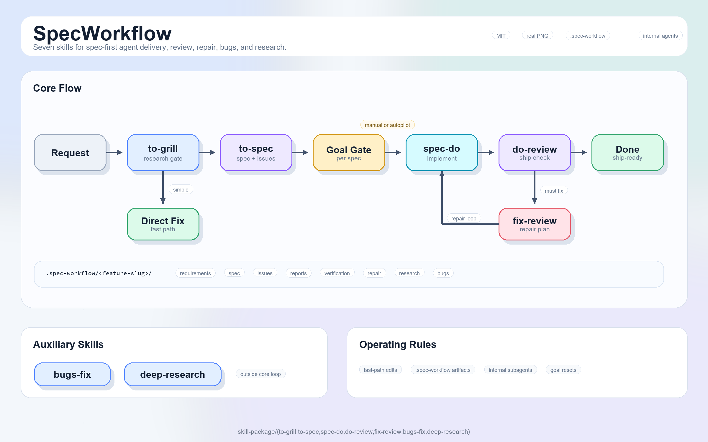

# SpecWorkflow

[English](README.md) | 中文

SpecWorkflow 是一套面向 DeepSeek Harness 和其它兼容 Agent Skills 工具的工作流技能包，涵盖需求澄清、需求规格、实施、交付审查、修复规划、问题诊断和一手来源调研。

简单明确的修改可以直接处理；需求模糊、跨模块，或影响产品体验、数据、权限、接口和发布风险的工作，才进入完整工作流。



## 功能

| 阶段 | Skill | 处理内容 |
| --- | --- | --- |
| 调研 | `deep-research` | 基于官方文档、API、标准、源码等一手来源做调研。 |
| 1 | `to-grill` | 需求质询、消除歧义、风险审查，并判断直接实施还是进入完整流程。 |
| 2 | `to-spec` | 编写可实施的需求规格、修订说明、验收标准、验证计划和可选任务单。 |
| 3 | `spec-do` | 根据已批准的需求规格、任务单、修订或修复计划进行实施。 |
| 4 | `do-review` | 对照需求、规格、代码和证据做最终交付审查。 |
| 5 | `fix-review` | 把必须修复的问题整理成修复规格和修复任务单。 |
| 调试 | `bugs-fix` | 针对 bug、回归和性能问题做复现、根因定位、修复和证据留存。 |

## 安装

### DSH

```sh
dsh plugin --profile web add specworkflow
dsh web
```

### 其它 Agent

```sh
npx specworkflow install codex
```

使用 `-g` 安装到全局目录：

```sh
npx specworkflow install -g codex
```

需要时把 `codex` 换成其它预设：

| 输入 | 项目安装位置 | `-g` 全局安装位置 |
| --- | --- | --- |
| `codex`, `openai`, `agents`, `agent`, `agent-skills`, `agents-md`, `goose`, `zed`, `amp`, `sourcegraph-amp` | `.agents/skills` | `~/.agents/skills` |
| `gemini`, `gemini-cli`, `antigravity`, `google-antigravity` | `.agents/skills` | `~/.gemini/antigravity/skills` |
| `claude`, `claude-code`, `claudecode` | `.claude/skills` | `~/.claude/skills` |
| `cursor`, `cursor-agent`, `cursor-native` | `.cursor/skills` | `~/.cursor/skills` |
| `copilot`, `github-copilot`, `vscode`, `vs-code` | `.github/skills` | `~/.github/skills` |
| `dsh`, `deepseek`, `deepseek-harness` | `.dsh/skills` | `~/.dsh/skills` |
| `opencode`, `open-code` | `.opencode/skills` | `~/.opencode/skills` |
| `windsurf`, `cascade` | `.windsurf/skills` | `~/.windsurf/skills` |
| `cline`, `claudine` | `.cline/skills` | `~/.cline/skills` |
| `roo`, `roo-code`, `roocode` | `.roo/skills` | `~/.roo/skills` |
| `qwen`, `qwen-code`, `qwencode` | `.qwen/skills` | `~/.qwen/skills` |
| `kiro` | `.kiro/skills` | `~/.kiro/skills` |
| `kilo`, `kilo-code`, `kilocode` | `.kilo/skills` | `~/.kilo/skills` |
| `augment`, `augment-code`, `augmentcode`, `auggie` | `.augment/skills` | `~/.augment/skills` |
| `openclaw`, `claw` | `skills` | `~/.openclaw/skills` |

未识别的纯名称会直接报错，避免因为拼错而创建错误目录。如果当前工具不在预设里，请传入明确的项目级 skills 路径：

```sh
npx specworkflow install .my-agent/skills
```

带 `-g` 时，相对显式路径会从用户主目录解析。

## 快速开始

典型功能开发：

```text
使用 to-grill 澄清这个需求，需求收口后再进入 to-spec。
```

简单修改保持简单：

```text
把表格字体调大一点。
```

这类请求应该直接实施，不应该强行进入五阶段流程。

## 工作流

先判断需求是否需要正式规格。改一段文案、调一个样式、补一个明确遗漏的判断，这类小修改可以直接完成。

只有当需求开始牵涉产品含义、数据语义、权限边界、跨模块影响、发布风险，或者“做错了会很难收拾”时，才进入完整流程。同一件事产生的材料都放在同一个 `.spec-workflow/<feature-slug>/` 目录下，后续每一轮都能接得上。

```text
to-grill -> to-spec -> spec-do -> do-review -> fix-review -> spec-do repair -> do-review
```

`to-grill` 先读取上下文和现有实现，再询问需要用户决定的问题。阶段结束时，会明确直接修改、暂缓或编写需求规格，并留下下一阶段可读取的需求结论。

`to-spec` 将需求结论写成实施规格，说明做什么、不做什么、影响哪些模块、数据和权限如何处理，以及验收需要哪些证据。调整已有规格时，会保留修订记录和影响范围。

`spec-do` 按已批准的规格、任务单、修订或修复计划实施。动代码前检查 Git 分支和未提交改动；目标模式沿用最后选择的提交策略，分阶段执行则先确定提交权限。临时证据保存在 `.spec-workflow`，长期测试放在项目自己的测试目录。业务逻辑必须真实执行，不能靠模拟系统业务逻辑让验证通过。

`do-review` 对照原始需求、规格、代码 diff、测试和证据检查遗漏、回归、边界与验收缺口，给出可以交付、修复后交付或不可交付的结论。该阶段只审查，不修改代码或扩大范围。

需要修复时，`fix-review` 根据问题的根因、优先级和验证方式编写修复计划，必要时拆成任务单，再交给 `spec-do`。修复后由 `do-review` 再次检查，直到可以交付或出现需要用户决定的阻断。

`deep-research` 和 `bugs-fix` 不属于主链上的固定阶段，更像两条随时可以插入的支线。遇到外部事实、官方文档、API 行为、标准差异时，先用 `deep-research` 把依据找齐；如果起点不是新需求，而是失败、回归、异常或性能问题，就直接走 `bugs-fix`，先复现和定位根因。

### 目标模式

目标模式放在 `to-spec` 最后选择。需求、测试方案、任务单、分支处理和完整规格都先确定，再展示本次的规格版本、完成标准、修复次数上限、执行方式和提交策略。提前说“后续自主执行”只记录意向，不会启动目标。

自动修复次数默认推荐 **3 次**，同时提供 **5 次、10 次、自定义**。该上限仅限制当前规格的修复循环，目标达成就提前结束。次数在最后的执行选择前确定；宿主续跑上限和 token 预算单独记录。

选择目标模式代表同意本次执行；真正启动仍要经过宿主操作。有目标 API 时，Agent 必须创建或复用当前规格的目标，并读回状态验证。只能通过用户命令或界面启动时，会显示“等待宿主启动”。仅记录“目标模式：仅对当前规格启用”不能证明启动成功。

启动后，实施、交付审查、修复规划和修复实施连续推进，已确定的需求、测试和提交策略不重复询问。范围内的缺陷由 Agent 修复。新产品选择、范围变化、文件归属冲突、必要验证不可用或次数耗尽时，先记录阻断，再提问。新的规格或修订版本必须重新选择。

未核实持久目标或循环机制时，只能明确提供**当前会话连续执行**，宿主结束回合后不保证自动续跑。自动批准和跳过权限不能代替目标驱动。各工具的入口和验证方式见[运行适配说明](skill-package/to-spec/references/agent-runtime-adapters.md)。

| 工具 | 目标或续跑入口 |
| --- | --- |
| Codex | 有目标工具时直接调用；否则由用户在当前对话提交 `/goal`。 |
| Claude Code | 用户提交 `/goal <condition>`，检查活动指示和状态。 |
| Cursor | 已开放该功能的版本使用 `/goal [objective]`。 |
| DSH | 调用 `create_goal`，并核对官方续轮驱动器、活动状态 `active` 和续跑状态 `armed`。 |
| Copilot CLI | 切到实际的 Autopilot 模式后提交当前规格的执行提示，或接受已就绪计划并开始执行。 |
| Qwen Code、Kiro CLI、Kilo Code、Antigravity、Junie、Hermes | 已核实原生目标入口；审批、状态、完成判定和恢复规则按产品分别处理。 |
| 其它工具和未来版本 | 先自行调研当前宿主，再决定执行方式；自动批准或目标状态持久化本身不足以证明自主续跑。 |

内置的[调研目录](skill-package/to-spec/references/additional-agent-runtimes.md)覆盖 30 个工具和产品，包含安装器预设涉及的全部宿主，保存了启动步骤、执行表面、生命周期限制和一手来源。证据不足的明确标注。

新 Agent、入口缺失、版本变化或资料冲突都会触发[内置兜底调研](skill-package/to-spec/references/runtime-discovery.md)：Agent 自己检查当前工具和帮助菜单，读取最新官方文档或源码，把本次结果存到 `.spec-workflow/<feature-slug>/research/agent-runtime.md`，确认真实启动后才实施。它不会自动重写已安装 skill，也不会因为查到一种方法，就自行装插件、提高权限或新开云任务。

### 展示语言与阶段交接

七个技能各自内置[中英对照与读取规则](skill-package/to-spec/references/bilingual-output.md)。中文请求使用中文问题、进度、报告标题和交付结论；英文请求使用英文，不要求每句话同时展示两种语言。编程术语、实际命令/API 字段、文件路径和原始证据保留真实写法。

语言要求按对象生效：中文对话里指定“报告用英文”，报告使用英文，日常进度和提问仍使用中文；只有明确要求全部切换，才改变所有输出。子代理及中断续作都会接收并沿用这套已确定的规则。

后续阶段会识别“完成状态：完成”“交付结论：可以交付”，也兼容旧英文和混合材料；状态仍按任务、审查、目标执行等领域判断，翻译不改变授权或修复计数。技能面板元数据只有静态字符串，因此使用中英双语标签，不宣称能自动切换语言。

## 目录产出

工作流材料保存在 `.spec-workflow` 下。

```text
.spec-workflow/<feature-slug>/
  requirements.md
  spec.md
  issues/
  amendments/
  implementation/
  review/
  repair-spec.md
  repair-issues/
  verification/
  debug/
  bugs/
  research/
```

项目长期测试仍然放在项目原本的测试目录，不放进 `.spec-workflow`。

## 验证

安装到 DSH 后运行：

```sh
dsh --profile web --dump-config
```

组合配置里应该出现：

```text
# == specworkflow
- id: specworkflow
  name: specworkflow
```

也可以直接询问 Agent 当前有哪些 SpecWorkflow skills，以及什么时候使用 `to-grill`。

## 卸载

```sh
dsh plugin --profile web remove specworkflow
```

把 `web` 换成你实际安装的 profile。

## 许可证

MIT，见 [LICENSE](LICENSE)。
